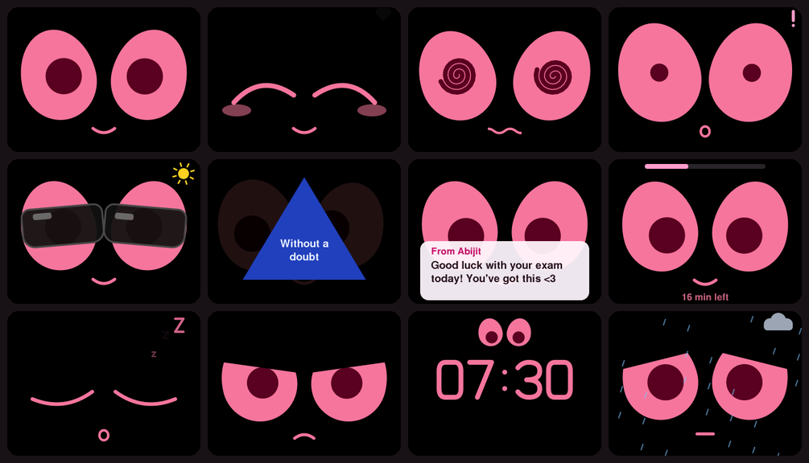
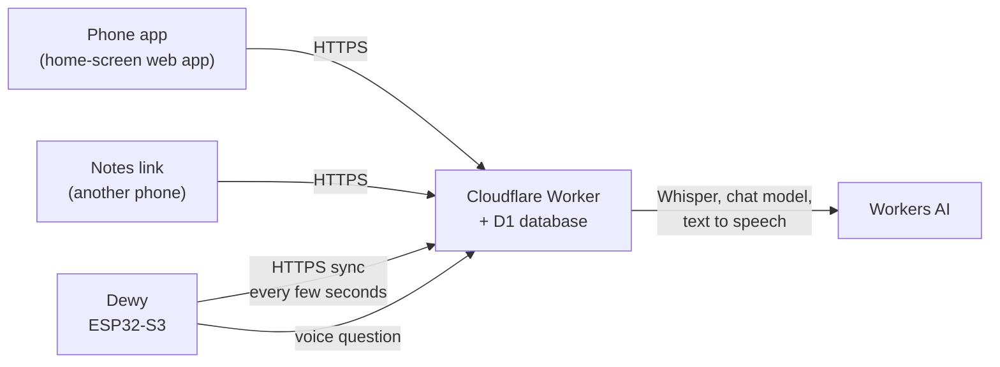

# Dewy, the desk buddy

Dewy is a little robot that lives on a desk. It blinks, looks around, gets bored, naps and wakes up with new
eyes. You play with it by touching and moving it, and it keeps you company with study timers, reminders, the
weather and notes sent from far away.

Dewy runs on an ESP32-S3 with a 3.2" touch screen and a motion sensor in a 3D-printed case. A small Cloudflare
server and a phone app connect it to the internet. I'm building it as a gift and as my TinkerHub scholarship
project. Follow along in the [build log](docs/BUILD_LOG.md).

> **Status (17 Nov 2026):** the face, touch, motion, Wi-Fi and the cloud all work on the real board. Voice
> (mic, speaker and the "Hey Dewy" wake word on the board) is next, and the parts arrive on 20 Nov. The
> prototype is due on 30 Nov.

## What it does

| | |
|---|---|
| **A face that's alive** | 12 moods, blinking, glancing around and breathing, drawn from scratch at about 50 frames a second. New eye colours (46 sets, some rare) and pupil shapes every time it wakes |
| **Touch** | Poke it and it squints; poke it 5 times and it gets grumpy; hold a finger on it and it blushes |
| **Motion** | Shake it (dizzy spiral eyes), pick it up (surprised), lean it (the eyes roll downhill), lay it face down (quiet time) or turn it upside down ("Flip me back!") |
| **Magic 8-ball** | Tap, then shake within 4 seconds |
| **A bond that grows** | From stranger to friend, close friend, best friend and soulmate. It celebrates each level and misses you when you're away |
| **Helpful bits** | Weather in its eyes (sunglasses, a cloud, rain), a study timer, water and stretch reminders, alarms, a clock and a birthday party |
| **Notes from afar** | Notes sent from a phone pop up on its screen, even from another city |
| **Phone app** | A home-screen web app for timers, alarms, reminders, settings and an on/off switch |
| **Voice** *(coming soon)* | "Hey Dewy" wake word on the board, then a spoken answer: weather, news, the time, notes and timers |

## How it fits together

- **Dewy** draws its face on one core, and runs the wake word and network on the other.
- **The Worker** stores settings, queues notes and timers for Dewy, offers firmware updates and answers spoken
  questions. It fits in Cloudflare's free plan.
- **Pairing:** Dewy shows an 8-character code, and the phone app sends it to get its own token. Every token is
  stored only as a hash.

## Hardware

| Part | Notes |
|---|---|
| ESP32-S3-N16R8 dev board | 16 MB flash, 8 MB PSRAM. On some clones the 5V pin only outputs USB power after you bridge the **IN-OUT** pads |
| 3.2" ILI9341 screen, 40-pin (SmartElex) | 8-bit parallel mode (IM2/IM1 to GND, IM0 to 3V3) with XPT2046 resistive touch |
| GY-87 (MPU6050) | Shake, pick-up, tilt, face down and upside down |
| INMP441 microphone, MAX98357A amplifier, small speaker | Voice (being added) |
| 220 µF capacitor | Across the screen's 5 V supply |
| 3D-printed case | [`case/`](case/) |
| Carrier PCB *(v0.1, not yet made)* | [`pcb/dewy_carrier/`](pcb/dewy_carrier/): every module solders onto one board, with no loose wires |

Full pin tables are in [`firmware/dewy/config.h`](firmware/dewy/config.h) and
[`firmware/README.md`](firmware/README.md).

## Repository

| Folder | What's in it |
|---|---|
| [`firmware/`](firmware/) | The Arduino code, PC tests (renders, motion, bond, voice and cloud checks) and a Wokwi simulator copy |
| [`cloud/`](cloud/) | The Cloudflare Worker, its database migrations, the phone app and end-to-end tests |
| [`voice/wakeword/`](voice/wakeword/) | Training the "Hey Dewy" wake word (microWakeWord) and the trained model |
| [`case/`](case/) | Printable STL files and the scripts that make them |
| [`pcb/dewy_carrier/`](pcb/dewy_carrier/) | The carrier board: KiCad file, Gerbers and the scripts that place and route it |
| [`docs/`](docs/) | The illustrated manual and the [build log](docs/BUILD_LOG.md) |

## Build your own

1. **Firmware:** follow [`firmware/README.md`](firmware/README.md). It covers the Arduino IDE or `arduino-cli`
   with the ESP32 core 3.3, OPI PSRAM, 16 MB flash, and the `SCREEN_PARALLEL` build flag.
2. **Private settings:** copy `firmware/dewy/secrets.example.h` to `secrets.h`. Git never uploads that file.
3. **Server and app (optional):** follow [`cloud/README.md`](cloud/README.md). It takes about 10 minutes on a free
   Cloudflare account.
4. **Wake word (optional):** see [`voice/wakeword/README.md`](voice/wakeword/README.md). Training runs on an
   NVIDIA GPU under WSL2.

Tests: `bash firmware/test/run_tests.sh` (firmware, on a PC), and `npm test` in `cloud/` with `npm run dev`
running.

## Licence

Dewy is free to build, study, change and share for **non-commercial** use. Please don't sell it, or sell things
made from it.

- **Code** (firmware, cloud, tools, scripts): [PolyForm Noncommercial 1.0.0](LICENSE)
- **Designs and docs** (`case/`, `pcb/`, `docs/`): [CC BY-NC 4.0](LICENSES/CC-BY-NC-4.0.txt)
- **Third-party parts keep their own licences:** see [NOTICE.md](NOTICE.md). The wake word model is for
  personal, non-commercial use, because some of the sounds it was trained on are licensed that way.

Made by Abijit Arun ([@abijit2626](https://github.com/abijit2626)).
